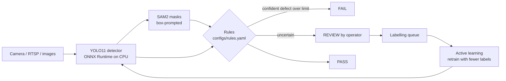

# 🔍 Steel Surface Defect Inspection: YOLO11 + SAM2, Real-Time on CPU / Edge

> Detects and measures surface defects on hot-rolled steel (and PCBs) from camera images, decides **PASS / REVIEW / FAIL** with rules quality engineers can edit, and runs in real time on a factory PC with only ONNX Runtime: no GPU, no PyTorch on the line.

    

## What it does



- **Detection:** YOLO11 trained on NEU-DET's 6 classes: crazing, inclusion, patches, pitted surface, rolled-in scale, scratches.
- **Measurement:** SAM2, prompted with each YOLO box, gives a pixel mask, so a defect is reported as area (% of surface, or mm² with camera calibration), not just a box. An OpenCV GrabCut fallback runs anywhere.
- **Decision:** `configs/rules.yaml` sets the fail confidence, a review band for uncertain detections (sent to a person *and* to the labelling queue), and per-class size tolerances (e.g. small cosmetic patches pass).
- **Edge deployment:** export to ONNX (FP32) and OpenVINO (INT8). The production path (`onnx_detector.py`) needs only `onnxruntime`, OpenCV and NumPy: letterboxing, decoding and NMS are implemented here, not hidden in a framework.
- **Active learning:** expert labelling is the expensive part of factory AI. The pipeline picks the images the model is least sure about (plus a diversity step, so it doesn't pick 50 copies of the same scratch) and measures mAP vs. labels against random selection.
- **Honest measurement:** our own COCO-style evaluator (matches pycocotools' 101-point AP) scores *any* model (PyTorch, ONNX, INT8), so the accuracy cost of edge quantisation is measured on the same test split.

## Results

Train with one click on a free Colab GPU: open [`notebooks/train_colab.ipynb`](notebooks/train_colab.ipynb), choose a T4 GPU, run all. The notebook fills this table (NEU-DET, held-out test split = 15% of images, stratified by class):

| Model | Format | mAP@50 (test) | mAP@50-95 | CPU latency / FPS | Notes |
|---|---|---:|---:|---:|---|
| YOLO11s | PyTorch (GPU) | _run notebook_ | _run notebook_ | n/a | reference |
| YOLO11s | ONNX FP32, CPU 2 threads | _run notebook_ | _run notebook_ | _run notebook_ | `scripts/benchmark_onnx.py` |
| YOLO11s | OpenVINO INT8, CPU | _run notebook_ | _run notebook_ | _run notebook_ | edge |

Active learning (YOLO11n, 40 epochs per round, start with 20% of training labels, +10% per round):

| Labelled images | Random | Uncertainty + diversity |
|---:|---:|---:|
| 20% | _run_ | _run_ |
| 30% | _run_ | _run_ |
| 40% | _run_ | _run_ |
| 50% | _run_ | _run_ |

Known limitation: every NEU-DET image contains a defect, so false alarms on defect-free parts cannot be measured on this dataset; add good-part images from the real line before deployment.

## Quickstart

```bash
git clone https://github.com/alihassan891u-lab/steel-defect-inspection.git && cd steel-defect-inspection
pip install -e ".[dev]"            # inference + tests: numpy, opencv, onnxruntime
pytest -q

# data -> YOLO format (NEU-DET, or any VOC dataset such as PCB defects with --classes)
python scripts/prepare_data.py --raw data/raw --out data/neu_yolo

# train + test + export (GPU)
pip install -e ".[train,edge]"
python -m defectinspect.train --data data/neu_yolo/data.yaml --model yolo11s.pt --epochs 100

# CPU benchmark + accuracy of the exported model
python scripts/benchmark_onnx.py --model runs/defects/train/weights/best.onnx --data data/neu_yolo --threads 4

# real time from a USB camera / RTSP stream / video file
python -m defectinspect.realtime --model weights/best.onnx --source 0
python -m defectinspect.realtime --model weights/best.onnx --source rtsp://camera/stream --headless --log results/line1.jsonl

# operator UI and line/MES API
DEFECT_MODEL=weights/best.onnx streamlit run app/streamlit_app.py
DEFECT_MODEL=weights/best.onnx uvicorn defectinspect.api:app --port 8000   # POST /inspect -> verdict, defects, annotated image
```

Docker (CPU inference only): `docker build -t defect-inspect . && docker run -p 8000:8000 -v $PWD/weights:/app/weights defect-inspect`

## Project layout

```
src/defectinspect/
  data.py             VOC -> YOLO conversion, stratified train/val/test split
  metrics.py          COCO-style AP, mAP@50, mAP@50-95 (pycocotools-equivalent)
  onnx_detector.py    letterbox, YOLO11 output decoding, class-wise NMS, CPU benchmark
  train.py            YOLO11 training (inspection-specific augmentation), test eval, ONNX/OpenVINO INT8 export
  segment.py          SAM2 box-prompted masks; GrabCut fallback
  quality.py          PASS / REVIEW / FAIL rules, defect area, annotated output
  active_learning.py  uncertainty + k-center diversity selection; learning-curve experiment
  realtime.py         camera / RTSP / video loop with FPS and defect log
  api.py              FastAPI service
notebooks/train_colab.ipynb   one-click training, export, benchmark, SAM2 demo, active learning
tests/                synthetic steel images with known defects: conversion round-trip, metric reference values,
                      ONNX decoding through letterbox, NMS, rules, GrabCut masks, active-learning selection
```

## Data and license

NEU-DET: NEU surface defect database (K. Song, Y. Yan, Northeastern University), 1,800 grayscale 200×200 images, 6 classes, VOC boxes; research use, download it from the original source and respect its terms. Code: MIT © Ali Hassan.
